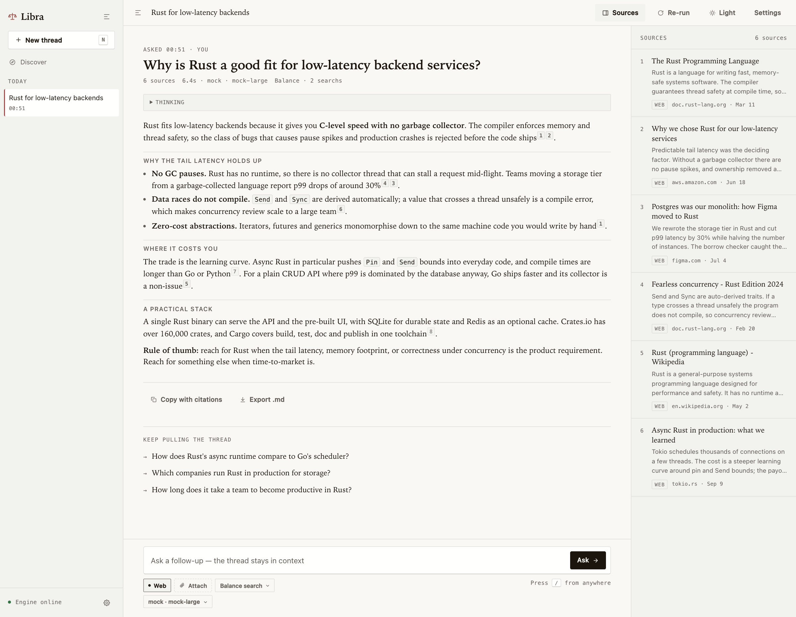
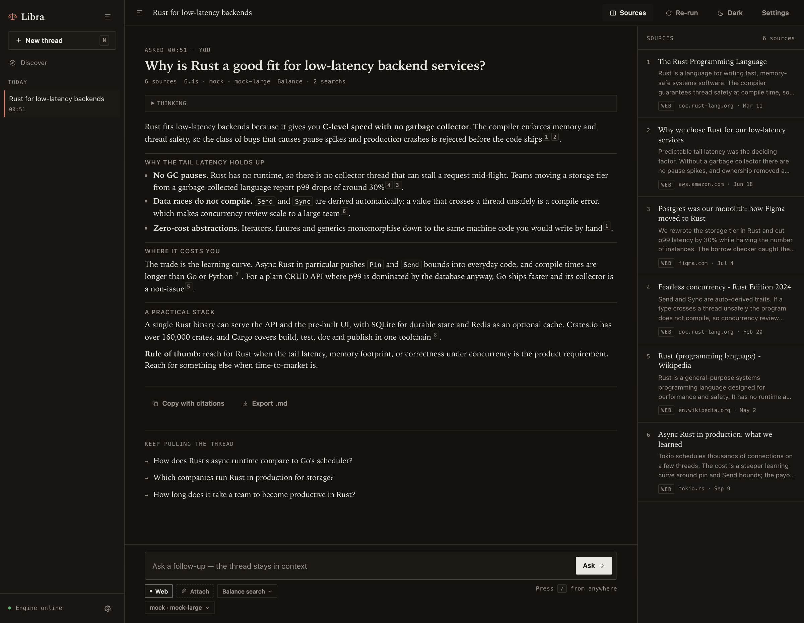
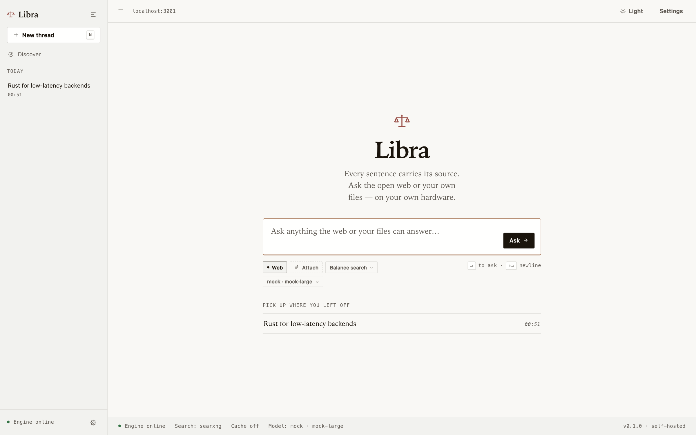
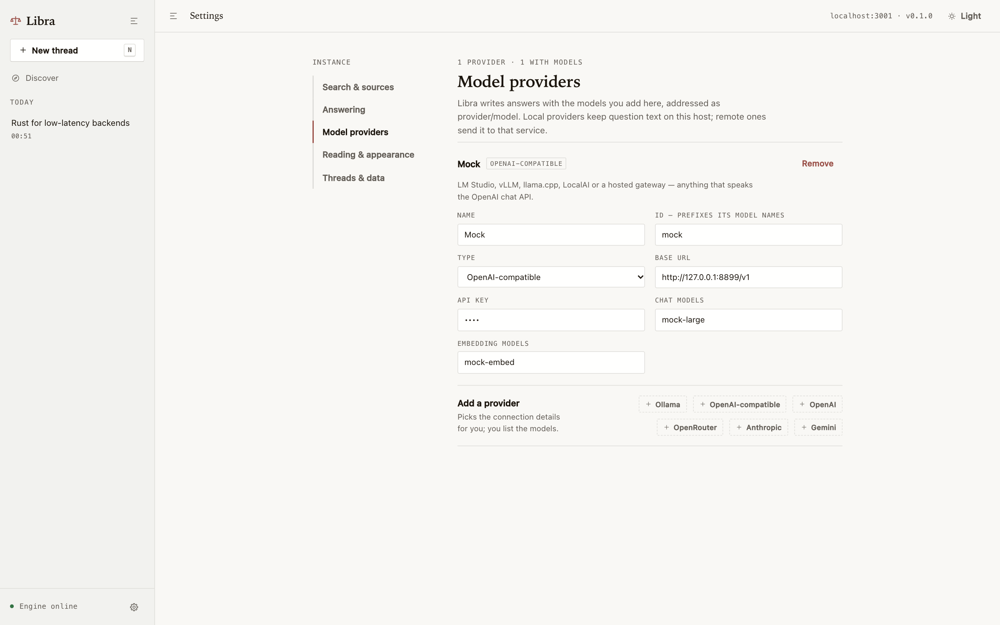
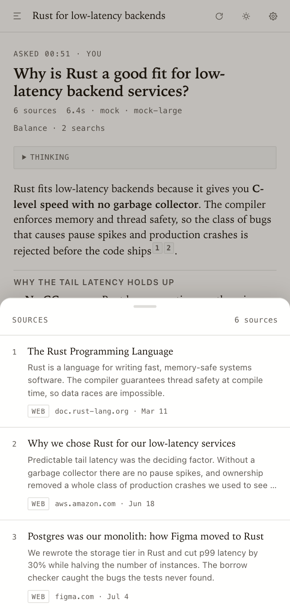

<h1 align="center">⚖️ Libra</h1>

<p align="center">
<b>A self-hosted answer engine — a Perplexity you run yourself.</b><br>
Ask in plain language, get a cited answer from the open web, on your own hardware.<br>
Rust + axum + SQLite, an optional Redis cache, a Next.js front end.<br>
One binary serves the API and the pre-built UI.
</p>

<p align="center">

</p>

<p align="center">
<a href="LICENSE">MIT</a> · <a href="#quickstart">Quickstart</a> · <a href="#how-it-works">How it works</a> · <a href="#http-api">HTTP API</a> · <a href="#configuration">Configuration</a>
</p>

---

## What you get

- **Cited answers, not links.** Every claim carries an `[n]` that points at the source it came from. Copy with citations, or export the turn as `.md`.
- **Two lengths.** A short answer leads with the result and stops. A **discussion report** plans 4–6 sections from the same research and writes them one after another — still cited, still one stream.
- **A research loop you can tune.** `Fast` runs one round of searches, `Balance` adds a follow-up round, `Deep` adds two. The same question, three levels of effort.
- **Any model you already have.** Ollama, LM Studio, vLLM, OpenAI, OpenRouter, Anthropic, Gemini, or any OpenAI-compatible server — and a different model for the answer, the background chores, and the reranking.
- **Search that degrades gracefully.** SearxNG, Brave, Tavily, Exa, DuckDuckGo, Bing HTML scraping and Firecrawl, tried in an order you set per result kind. No key? Self-hosted SearxNG works alone.
- **Answers that do things.** Calculator, currency conversion, world clock, weather (Open-Meteo) and stock quotes with charts (Nasdaq) render as blocks above the prose.
- **Your files and your photos.** Upload `txt`, `md`, `csv`, `pdf`, `docx` or images; documents are chunked, embedded and retrieved by cosine similarity, images go to a vision model.
- **Image and video results, a Discover feed** (tech, finance, art, sports, entertainment) that opens a thread summarising the story, and optional image generation.
- **An Automator.** Cron jobs Libra runs for you: one shell line inside a throwaway [microsandbox](https://github.com/superradcompany/microsandbox) microVM, or a saved question whose answer is filed as a thread. Per-job timezone, run history, run-now, and a message when a run ends — a webhook per job, or Telegram for the whole instance. Or say one sentence and the AI helper writes the job.
- **Multilingual.** Ask in Chinese, get a Chinese answer and a Chinese thread title.
- **Stops, survives, reloads.** Answers stream over SSE; reloading mid-answer restores the partial turn and keeps polling. Stopping keeps what was written. No accounts, no cookies, no telemetry.
- **Optional access token.** Set one env var and every `/api` call needs it; cross-origin access is closed by default. See [Securing it](#securing-it).
- **Made for reading.** Serif or sans answer typeface, an answer-width slider, light / dark / system, `/` to ask from anywhere, `N` for a new thread.

<p align="center">
<b>Dark mode</b> — the same thread at 2 a.m. &nbsp;·&nbsp; <b>The empty state</b> is the whole onboarding.<br>
 
</p>

<p align="center">
<b>Settings → Model providers</b>: add a provider, list its models, done. &nbsp;·&nbsp; <b>On a phone</b>: the same thread, sources in a sheet.<br>
 
</p>

## How it works

```
question
  ↓
classify          normal / coding / follow-up / quick lookup, + should the answer carry images or videos
  ↓               → calculator · world clock · weather · stock quotes
plan searches     the light model picks the queries, in the question's language
  ↓
search rounds     fast = 1 round · balance = 2 · deep = 3
  ↓
filter → rerank   the light model drops dead sources, the rerank model orders the rest
  ↓
answer            the answer model writes, citing [n] for every claim
  ↓               → a discussion report outlines 4–6 sections first, then writes them one by one
references · images · videos · follow-up questions
```

Uploaded documents (chunked + embedded) and attached images are retrieved alongside the web
searches and land in the same reference list. Everything above streams to the browser as blocks
over one SSE connection, and every block is stored, so a thread reloads exactly as it was answered.

### Why this shape

| | [Vane](https://github.com/ItzCrazyKns/Vane) (what this is a rebuild of) | Libra |
|---|---|---|
| backend | Next.js (Node) | Rust (axum), single static binary |
| storage | SQLite (drizzle) | SQLite (sqlx, WAL) |
| cache | none | Redis: search results, embeddings, discover, single-flight |
| research loop | native tool-calling, 2–25 iterations | plan the queries, then 1, 2 or 3 search rounds (fast, balance, deep) |
| providers | OpenAI/Anthropic/Gemini/Groq/Ollama/… | OpenAI-compatible (incl. OpenRouter, Ollama, LM Studio), Anthropic, Gemini |
| search | SearxNG only | SearxNG, Brave, Tavily, Exa, DuckDuckGo, Bing HTML scrape, Firecrawl — per-kind ordered fallback |
| UI | full React app | lean Next.js app, statically exported and served by the Rust binary |

The research loop is the main behavioural deviation. Upstream drives a multi-iteration agent
through native tool calls, which needs a strong model. Libra instead asks the **fast** model what
to search first, runs those queries, then asks it what to search next. Balance does one follow-up
round, Deep does two, Fast stops after the first. The fast model then drops sources that cannot
help, the **rerank** model orders what remains, and Libra reads the question's links and
those sources before the **answer** model writes. [Obscura](https://github.com/h4ckf0r0day/obscura)
does that read when it is installed: it runs the page's scripts and, in a stealth build, fetches
with a browser-like TLS fingerprint. Without the binary, Libra falls back to a plain HTTP fetch.

Three model slots, so a 7B local model can plan and filter while a bigger one writes:

```
answer   → the writer. Strong, slow is fine.
light    → classify, plan searches, filter sources, titles, follow-ups. Fast and cheap.
rerank   → orders the surviving sources by relevance.
```

## Quickstart

```bash
docker compose up --build          # UI + API on http://localhost:3001
```

That brings up Libra, Redis and a SearxNG metasearch container. A fresh instance has no model
providers: open **`http://localhost:3001/settings/?tab=providers`**, add one (Ollama, OpenAI,
OpenRouter, Anthropic, Gemini or any OpenAI-compatible server) with the models it serves, and ask
something. Nothing else needs configuring — search works through the bundled SearxNG.

### Without Docker

```bash
cp .env.example .env                # optional: search keys, Redis, ports
cargo run                           # API + UI on :3001 (serves web/out)

# front end development, hot reload, proxies /api to :3001
cd web && npm install && npm run dev    # http://localhost:3000
```

Build the UI first if `web/out` is missing: `cd web && npm run build`.

Redis is optional. If `REDIS_URL` is unreachable the service logs a warning and runs with caching
disabled; `REDIS_DISABLED=1` skips the connection attempt entirely. SearxNG and every search key are
optional too — a provider is skipped when it has no key, is disabled, or returns nothing, and the
first provider that yields results wins.

## Configuration

Everything in `.env.example` can also be changed at runtime from `/settings`. Precedence:

```
env vars  →  $LIBRA_DATA_DIR/settings.json  →  PUT /api/settings (live, no restart)
```

Settings are held in an `Arc<RwLock<Config>>`; a change swaps the `Arc` and each in-flight request
keeps the snapshot it started with. No subsystem rebuild, no restart. Model providers and the models
chosen from them are the exception — those come only from Settings, never from env vars.

Search fallback order is per kind (`WEB_SEARCH_ORDER`, `NEWS_SEARCH_ORDER`, `IMAGE_SEARCH_ORDER`,
`VIDEO_SEARCH_ORDER`).

### Scheduled jobs

The Automator keeps its schedules on the host — microsandbox deliberately has no scheduler, so each
run is a fresh disposable microVM (`msb run --name libra-<job> --replace --memory 256M
--max-duration 5m -- <image> -- sh -lc '<command>'`) and the timer lives here. Command jobs need the
`msb` CLI on the machine serving Libra:

```bash
curl -fsSL https://install.microsandbox.dev | sh   # macOS / Linux; needs /dev/kvm on Linux, Apple Silicon on macOS
# MSB_BIN=msb                                      # or an absolute path to the binary
```

Prompt jobs need no extra binary: they call the same answer pipeline the UI uses, so the answer
appears in the sidebar and the run links to it. A job's optional `notify_url` gets a JSON `POST`
when a run ends — an ntfy topic works out of the box.

**Telegram tells you about every run at once.** In **Settings → Notifications** put a bot token from
[@BotFather](https://t.me/BotFather), send that bot `/start` once, press **Find my chat ID** — the bot
reads back the chats that have messaged it, because Telegram gives no way to look a chat number up —
and **Send a test** to prove it can post. Choose whether every finished run posts or only the ones that
went wrong (a timeout, a sandbox that never started, a non-zero exit). The message names the job,
the status, the exit code and the tail of the output. Keys can stay out of the settings file:

```bash
# TELEGRAM_BOT_TOKEN=123456789:AA…                  # or type it in Settings → Notifications
# TELEGRAM_CHAT_ID=-1001234567890                   # groups and channels need the bot added first
# TELEGRAM_API_URL=https://api.telegram.org         # a self-hosted Bot API server, if you run one
```

A notification that fails is a log line, never a failed run, and an unset token posts nothing.

**You do not have to write the cron expression.** Type one sentence into the Automator — *every
weekday morning at 8 London time, tell me what changed in the Rust release notes* — and its helper
fills the form: name, kind, schedule, timezone, and what the job should ask or run. It uses the light
model, saves the job switched on, and lists every field it had to guess so you can adjust what it got
wrong. A schedule it cannot read becomes 07:00 every day rather than an error, and a command job says
so, because that line runs in a microVM on your server.

**In Docker** the scheduler and prompt jobs need nothing extra — they are part of the Libra process.
Command jobs are different: the image ships `msb`, but a microVM needs hardware virtualization, so
the container must be given the hypervisor device:

```yaml
services:
  libra:
    devices:
      - /dev/kvm:/dev/kvm        # Linux Docker Engine only
    volumes:
      - microsandbox-data:/root/.microsandbox   # cached images survive restarts
```

Check what a container can actually do with `docker compose exec libra /opt/microsandbox/bin/msb
doctor` — it reports the KVM device explicitly. Docker Desktop on macOS usually does not expose
`/dev/kvm` to its Linux VM at all, and nesting a microVM inside a VM is slow even when it works, so
on a Mac prefer running Libra with `cargo run` (microsandbox uses Apple's own Virtualization
Framework there). If a command job cannot start its VM, the run log says so
(`sandbox process exited (signal: 6 …)`) rather than pretending the job ran.

### Securing it

Out of the box Libra has no accounts and no login: it trusts whoever can reach the port. Two env
vars change that.

```bash
LIBRA_AUTH_TOKEN=$(openssl rand -hex 24)   # every /api request needs Authorization: Bearer <token>
LIBRA_ALLOWED_ORIGINS=                     # browser origins allowed to call /api cross-origin
```

With a token set, the UI shows an unlock screen once per browser and keeps the token in
`localStorage`. It is read from the environment only — never from `settings.json`, and never
returned by `GET /api/settings`. `/api/health` needs it too, so a locked instance leaks nothing
about your providers.

`LIBRA_ALLOWED_ORIGINS` is **empty by default**, which means same-origin only: the single-binary
deployment serves the UI and the API from one origin, so it needs no CORS at all, and the Next dev
server proxies `/api` server-side. List origins (`http://localhost:3000`) only if you split them,
and set `LIBRA_ALLOWED_ORIGINS=*` to go back to the wide-open development layer — on a trusted
network only.

One token guards the whole instance; there are no users. The static UI is always public — it is an
empty app shell, every route that reads or writes data lives under `/api`. Put TLS and any real
multi-user auth in front of it with a reverse proxy.

## HTTP API

| | |
|---|---|
| `POST /api/ask` | SSE stream. Body `{id, query, model, models:{answer,light,rerank}, depth:fast\|balance\|deep, mode:answer\|discussion, files:[id], message_history:[{role,content}], filters:{country,language,freshness,perplexity_site}, disabled_widgets:[]}`. `depth` defaults to balance, `mode` to answer. |
| `GET /api/chats` · `POST /api/chats` | list / create. Each chat includes `status`, the phase of its latest answer |
| `GET /api/chats/{id}` | `{chat, messages:[{id,role,content,blocks,files,status,error,model,elapsed_ms,created_at}]}` |
| `PATCH /api/chats/{id}` | rename `{title, emoji}` · `DELETE` removes it |
| `POST /api/chats/{id}/stop` | stop the answer in progress; the partial answer stays stored |
| `POST /api/chats/{id}/location` | browser fix `{latitude, longitude, timezone, denied}` while an ask is waiting |
| `POST /api/upload` | multipart `chatId` + `files[]` → `{files:[{id,name,chunks}]}` |
| `GET /api/search?q=&kind=web\|news\|images\|videos` | raw provider results (Redis cached) |
| `GET /api/suggestions?q=` | search autocomplete |
| `GET /api/discover?topic=tech\|finance\|art\|sports\|entertainment` | recent news for that topic; a story opens a thread that summarises its URL |
| `POST /api/generate/image` | `{prompt}` → base64 image (needs an image model) |
| `GET /api/stocks/{symbol}` | chart series for the stocks widget |
| `GET /api/jobs` · `POST /api/jobs` | list / create an Automator job `{name, kind: command\|prompt, cron, timezone, image, command, prompt, memory, max_duration_secs, notify_url, enabled}` — 5-field cron, normalized on save |
| `POST /api/jobs/from-text` | the Automator helper: `{text}` (one sentence) → `{job, why, notes}` — the light model fills the job, `notes` lists what it guessed, and the job is saved |
| `POST /api/notifications/telegram/chats` | `{bot_token}` → `{chats: [{id, title}]}` — the chats that have messaged this bot, newest first. A blank token uses the saved one |
| `POST /api/notifications/telegram/test` | `{bot_token, chat_id}` → `{sent: true}` — one message to prove the bot can post there |
| `GET /api/jobs/{id}` · `PUT /api/jobs/{id}` · `DELETE /api/jobs/{id}` | read / replace / remove a job |
| `POST /api/jobs/{id}/run` | start it now, outside its schedule |
| `GET /api/jobs/{id}/runs?limit=20` | run history: status, exit code, stdout, stderr, and `chat_id` for prompt jobs |
| `GET /api/settings` · `PUT /api/settings` | read / patch the whole config, applied hot |
| `GET /api/models` · `GET /api/health` | model ids · status + redis + providers |

SSE frames are `data: {...}` with `type`: `id` (chat id), `b` (block), `t` (reasoning delta),
`a` (answer text delta), `loc` (ask the browser for a location; `precise: true` means coordinates),
`c` (error), `e` (end). Blocks are `{type, message, data}` — `answered`, `widget`, `weather`,
`stocks`, `calculation`, `time`, `research`, `references`, `images`, `videos`, `related`, `message`.

Every `/api` route rejects with `401` when `LIBRA_AUTH_TOKEN` is set and the bearer token is
missing or wrong.

The question is written to SQLite as soon as the ask starts, and the answer's phase (`search`,
`read`, `write`, then `done`, `stopped` or `error`), blocks and text are updated as they arrive.
Reloading the page restores that row immediately and keeps polling while the phase is still in
progress. A process restart marks any in-progress turn stopped, so a thread is never stuck on
"answering".

## Layout

```
src/
  main.rs            startup, config, graceful shutdown
  api.rs             axum router: /api/* + static UI
  config.rs          env + settings.json, hot-swappable SettingsHandle
  db.rs              sqlx pool, migrations, chats/messages/documents/chunks
  cache.rs           Redis wrapper; degrades to a no-op
  blocks.rs          the block protocol streamed to the UI
  llm/               openai-compatible, anthropic, gemini; SSE + JSON extraction
  search/            provider trait + 7 providers + fallback router with Redis cache
  pipeline/          ask(): classify → widgets → plan → rounds → filter → rerank → read pages → answer (or report) → suggestions
  fetch.rs           read cited pages with Obscura, or a plain HTTP fetch when it is not installed
  automator/         cron schedules, the msb call that starts one microVM per run, run history, webhooks,
                     and a helper that turns one sentence into a saved job
  notify.rs          Telegram Bot API: announce a finished run, list the chats that messaged the bot, test send
  uploads/           text/pdf/docx/image extraction, chunking, embedding, cosine retrieval
  widgets/           calculator, currency (ECB rates), time, weather (Open-Meteo), stocks (Nasdaq)
  prompts/           every LLM prompt; all of them return strict JSON
web/                 Next.js app router + plain CSS from the design/ mockups (static export)
design/              static HTML mockups the UI was built from
docker/              searxng settings
```

## Development

```bash
cargo run                          # backend on :3001
cd web && npm run dev              # frontend on :3000, /api proxied to :3001
cargo test                         # prompts, JSON extraction, chunking, docx, config, widgets
```

The whole pipeline can be exercised without a single API key:

```bash
python3 scripts/mock-llm.py &      # OpenAI-compatible stub on :8899
cargo run &                        # add a "mock" provider in Settings pointing at it
```

The stub answers every prompt with fixed JSON and streams a fake answer, which is enough to drive
classify → search → rerank → answer → suggestions end to end. It also answers the Automator helper,
so `POST /api/jobs/from-text` can be tried without a model of your own.

The screenshots in this README were taken that way: the real UI and the real pipeline, driven by a
stub OpenAI-compatible model (same trick as `scripts/mock-llm.py`, with different canned text) and a
stub SearxNG, so they do not depend on anyone's API keys. The answer text and the source list are
representative rather than real.

## Known limits

- **Page reading stops at an interactive challenge.** Obscura covers JavaScript and basic TLS fingerprint checks. Cloudflare challenges, Datadome, Akamai Bot Manager, and CAPTCHAs still come back empty, and the answer falls back to the snippet. Without the `obscura` binary the reader is a plain HTTP fetch, which misses script-rendered pages.
- **One shared token, not users.** `LIBRA_AUTH_TOKEN` is a single secret for the whole instance: no accounts, no per-thread ownership, no session expiry. Everything else about who may reach the port is your reverse proxy's job.
- **Currency rates are the ECB's daily reference set.** About 30 currencies from Frankfurter, with ExchangeRate-API as a fallback for the rest; a pair neither lists renders no widget. Rates update once a day and are cached for 6 hours.
- **A discussion report is one pass per section.** The sections do not see each other's prose, only the outline, so a report reads as six good paragraphs rather than one argued piece. It also costs 4–6 answer-model calls instead of one.
- **A stuck reasoner is cut off, not fixed.** If the answer model repeats itself while thinking, the stream is stopped after a few cycles and the turn reports it — an endless trace used to burn the whole context and save an empty answer. The light-model calls (plan, filter, rerank) are bounded by a token cap instead, so a loop there costs one slow round and falls back.
- **Embedding search is brute-force cosine** over SQLite BLOBs. Fine up to a few thousand chunks.
- **Command jobs only run where `msb` does.** microsandbox is beta: it needs KVM on Linux and Apple Silicon on macOS, so a container running Libra wants `/dev/kvm` passed through to schedule anything. Without the binary a job records an error run that says so, rather than pretending it ran.
- **The scheduler is a 20-second sweep**, not a realtime timer: a job fires within a tick of its minute, and a restart can delay one — missed runs are not caught up.

## Acknowledgements

Rebuilds the architecture and much of the behaviour of [Vane](https://github.com/ItzCrazyKns/Vane)
by ItzCrazyKns. Search by [SearxNG](https://github.com/searxng/searxng), weather by
[Open-Meteo](https://open-meteo.com/), stock quotes by Nasdaq's public endpoints.

## License

[MIT](LICENSE)
